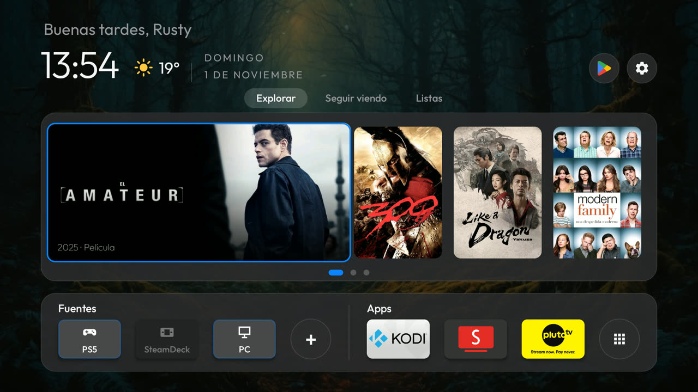
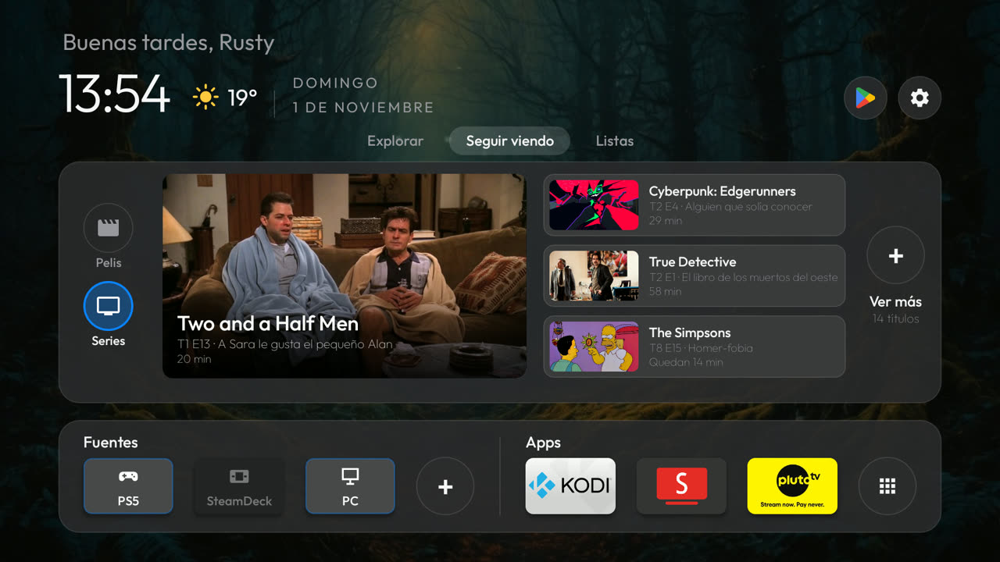
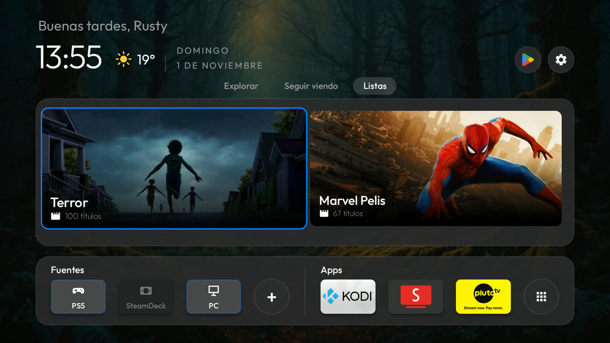
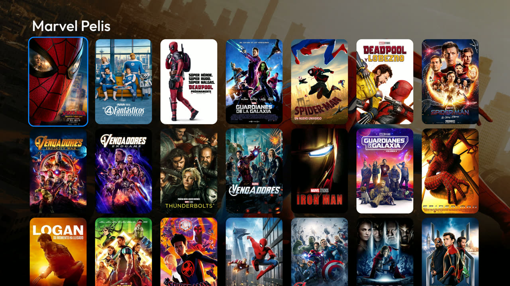
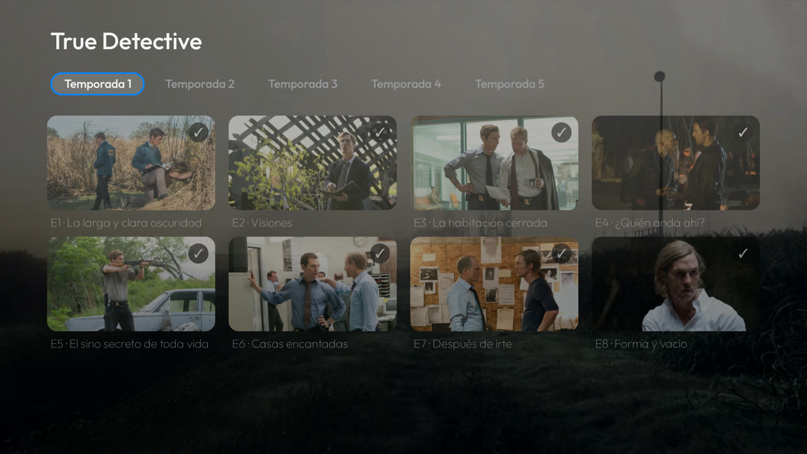
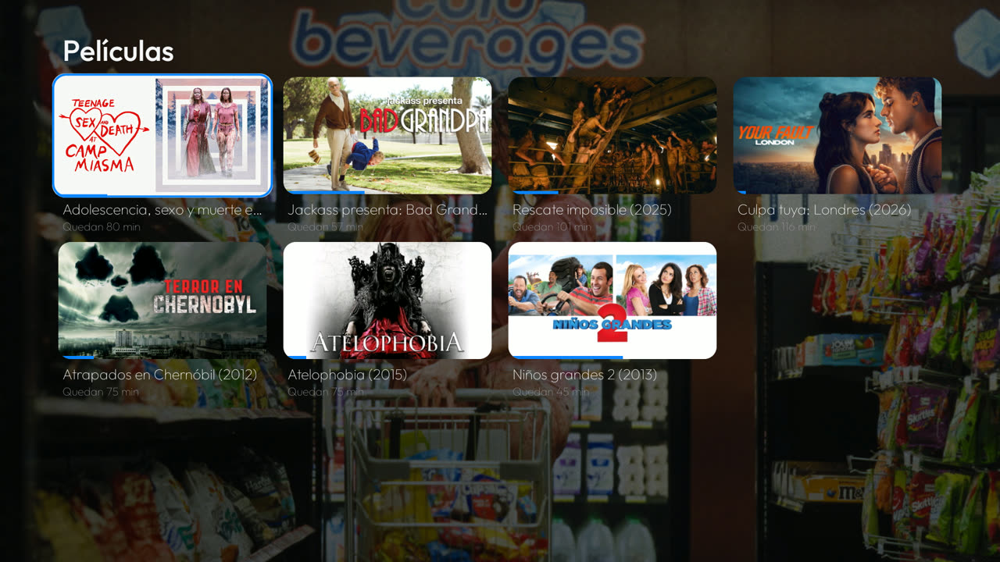
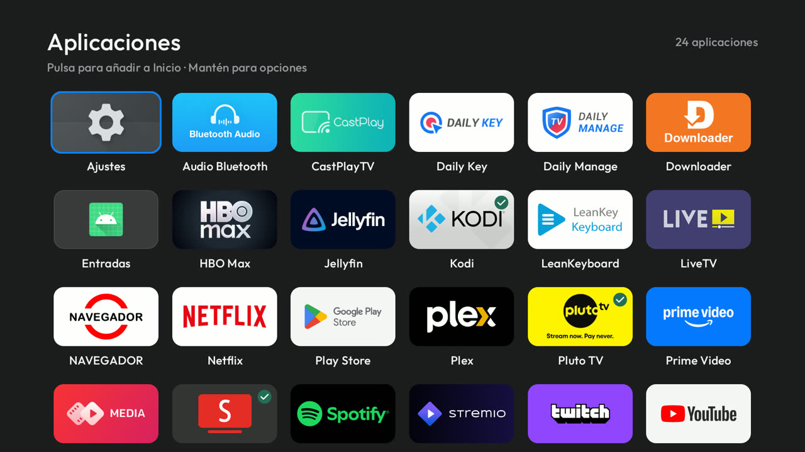
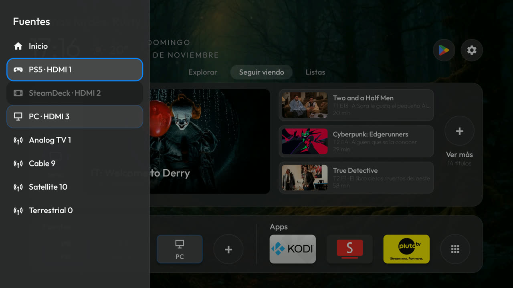
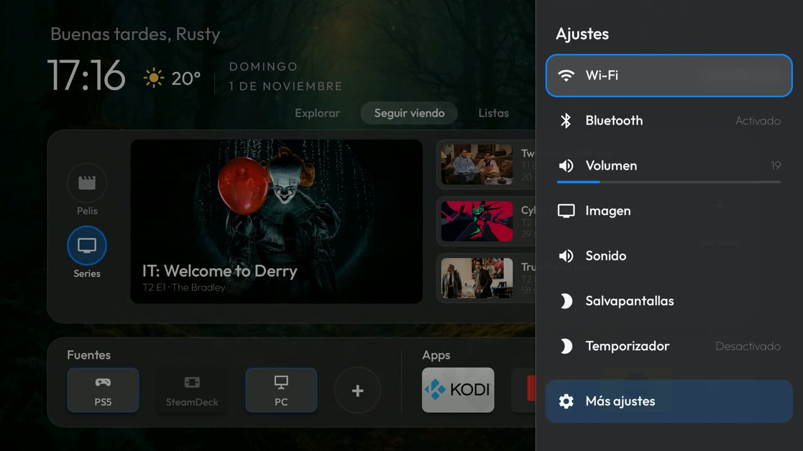

# ProjectCleanTV

Mi Android TV (Tesla 4K Smart TV FF, Google TV / Android 11) limpia por ADB y con una pantalla de inicio hecha a mi gusto.

Basado en [CleanYourTV](https://github.com/Gathin23/cleanyourtv) de Gathin (licencia MIT): de ahí salen el launcher de partida y las herramientas ADB de `tools/`. Todo lo demás es mío.



| Seguir viendo | Listas de Trakt |
|---|---|
|  |  |
| **Una lista** | **Una serie (pulsación larga)** |
|  |  |
| **Ver más** | **Aplicaciones** |
|  |  |
| **Fuentes (botón del mando)** | **Ajustes rápidos (engranaje)** |
|  |  |

- **Explorar:** 15 títulos al azar de la watchlist de Trakt en tres páginas que pasan solas con un fundido.
- **Seguir viendo:** lo que dejaste a medias y el siguiente capítulo de cada serie, con los minutos que quedan.
- **Listas:** tus listas de Trakt; una serie abre el capítulo que toca, y con pulsación larga su pantalla de temporadas.
- Todo se abre en Kodi con Palantir 3. Fuentes HDMI con su estado, y barras laterales de fuentes y ajustes rápidos con los botones del mando.

## Qué hay

| Carpeta | Qué es |
|---|---|
| `launcher/` | El launcher (`com.gathin.tvhome`), muy modificado: panel Explorar / Seguir viendo / Listas con Trakt y TMDB, abre en Kodi con Palantir 3, pantalla de serie, ocultar títulos, carrusel, fuentes HDMI con encendido/apagado, barra lateral de fuentes y de ajustes rápidos desde el mando, temporizador de apagado, fondo de vídeo e intro suave. |
| `themes/` | Mis temas: `minimal-dark` (el que uso), `minimal` y `cyberpunk`. |
| `tele/` | `debloat.txt`: lo que se desactiva (nunca se desinstala). `no-background.txt`: apps que no pueden arrancar solas en segundo plano. |
| `tools/` | Herramientas ADB: desactivar, restaurar, empujar un tema, capturas. |

**Para montarlo en otra tele o reinstalar esta: [GUIA.md](GUIA.md)** (paso a paso, también pensada para pasársela a una IA).

## Uso rápido

```bash
TV_HOST=<ip de la tele> tools/disable.sh tele/debloat.txt
```

```powershell
powershell -ExecutionPolicy Bypass -File tools/theme.ps1 themes/minimal-dark
```

El launcher se compila en `launcher/` con JDK 17 y el SDK 34 (`gradlew assembleRelease`) y se instala con `adb install -r`.
Las claves de Trakt y TMDB no están en el repo: se pasan a la tele por ADB.

## Licencia

MIT. Se conserva el aviso de copyright de CleanYourTV, como pide su licencia, junto al mío.
